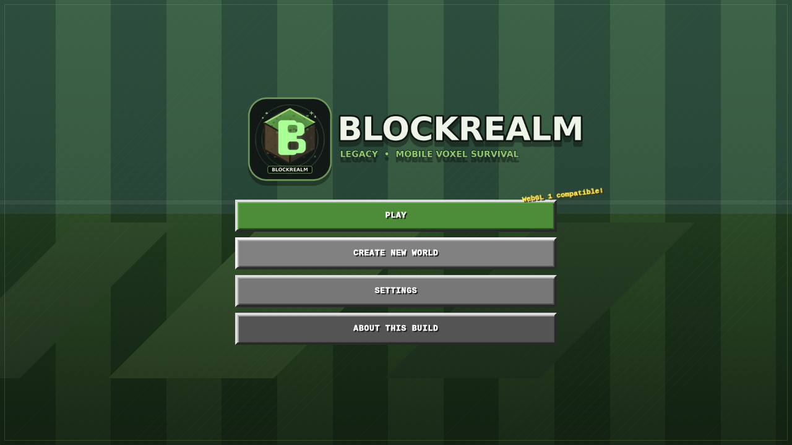

# BlockRealm: Legacy

> Open-source mobile-first voxel survival sandbox with procedural worlds, crafting, configurable shaders, offline PWA support, and an Android launcher.

[](LICENSE)
[](#platforms)
[](#graphics)
[](#project-status)



> [!IMPORTANT]
> BlockRealm is an original voxel sandbox project. It is not affiliated with, endorsed by, or distributed by Mojang Studios or Microsoft. Minecraft is a trademark of Microsoft.

## What is BlockRealm?

BlockRealm is an open-source voxel game built with JavaScript and WebGL. It combines deterministic procedural terrain, survival progression, crafting, configurable shaders, offline-first PWA support, and an Android launcher in a mobile-focused package.

It is designed as a browser-based survival sandbox and procedurally generated block world that can run on phones, desktops, and compatible Android WebViews.

## Features

- Deterministic seed-based procedural worlds
- Streamed voxel chunks with biomes, caves, ores, water, and vegetation
- Nine-slot hotbar and 36-slot survival inventory
- Crafting tables, furnaces, smelting, tools, durability, health, hunger, and oxygen
- Mobile-first touch controls plus desktop keyboard and mouse controls
- Configurable shader modes, including compatibility, reimagined, and cinematic presets
- Offline standalone HTML and installable PWA builds
- Android Studio launcher project
- Original open-source voxel survival game foundation

## Platforms

| Platform | Status | Notes |
|---|---|---|
| Modern desktop browsers | Supported | WebGL-capable browser required |
| Android mobile browsers | Supported | Landscape orientation recommended |
| Installable PWA | Supported | Requires HTTPS or localhost |
| Android APK | Experimental | Rebuild and physical-device testing recommended |

## Project status

The browser/PWA build has been confirmed to render on a Realme 13 Pro+ 5G. The earlier APK wrapper showed a black screen because the packaged launcher did not match the maintainable Android source project. The bundled APK is therefore marked **experimental** until it is rebuilt through Android Studio or CI and physically tested.

## Repository layout

- `web/` — browser and PWA game
- `android/` — Android Studio launcher project
- `docs/` — screenshots, release notes, QA notes, FAQ, architecture, and roadmap
- `releases/` — experimental APK artifact

## Run the web build

```bash
cd web
python -m http.server 8080
```

Open `http://localhost:8080`.

## Android build

Open `android/` in Android Studio, allow Gradle sync to complete, and build a debug APK. Never commit signing keys, keystores, passwords, or `local.properties`.

## Graphics

BlockRealm supports multiple graphics modes so users can balance quality and performance:

- Compatibility mode
- Reimagined shader mode
- Cinematic shader mode
- Shader-disabled mode

The renderer includes directional lighting, fog, animated water, day/night transitions, torch lighting, and optional atmosphere effects.

## Documentation

- [FAQ](docs/FAQ.md)
- [Architecture](docs/ARCHITECTURE.md)
- [Roadmap](docs/ROADMAP.md)
- [Contributing](CONTRIBUTING.md)
- [Changelog](CHANGELOG.md)

## Search and discovery terms

BlockRealm is an open-source voxel game, browser-based survival sandbox, mobile WebGL game, procedurally generated block world, offline Minecraft-inspired sandbox, and Android voxel game.

## License

Licensed under the Apache License 2.0. See `LICENSE` and `NOTICE`.

The BlockRealm name, logo, and branding are not granted for unrestricted use under the Apache License 2.0 except as necessary to identify the origin of the project.

Copyright 2026 GamerzArtist
